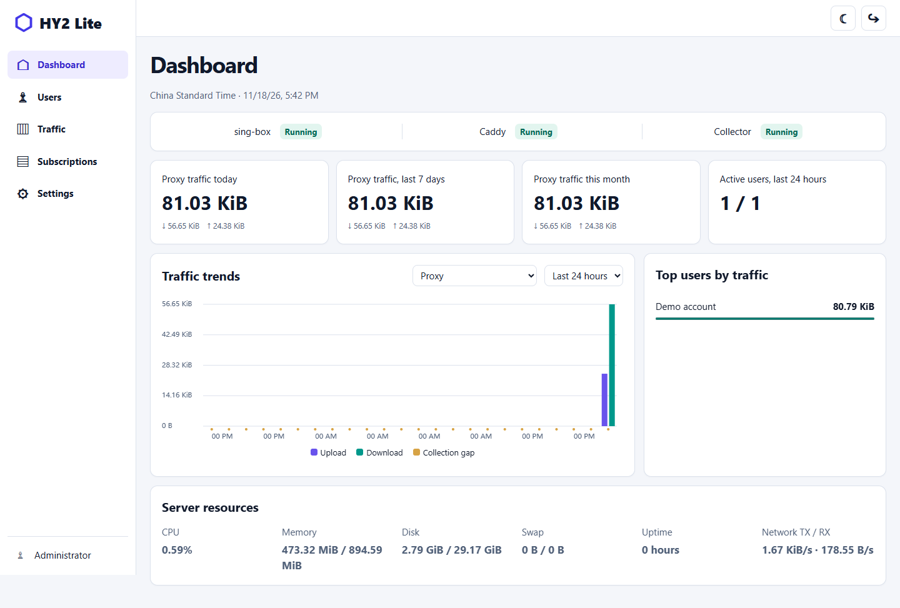
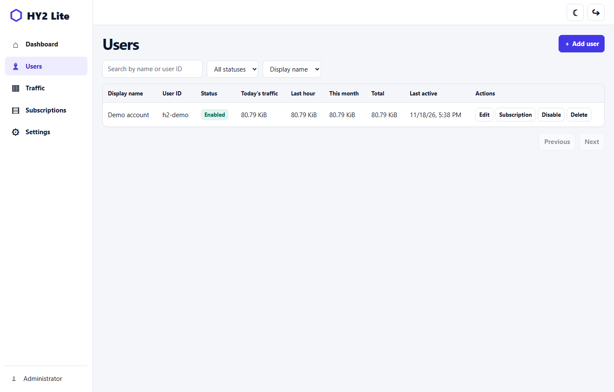
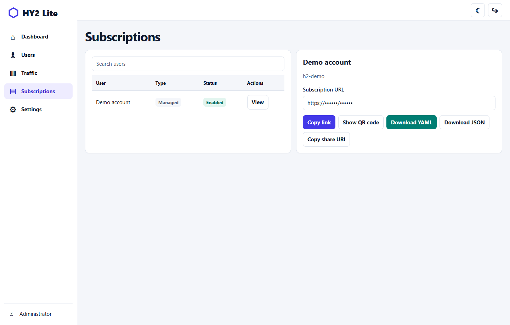

# 快速创建专属于自己的海外VPS

本项目可以让你快速的在阿里云的服务器上部署一台属于自己的海外VPN，让你告别机场不稳定，网速慢得难题，并通过英文网页面板管理账号、订阅和流量。初次安装可直接使用公网 IPv4，之后再绑定域名。

## 管理界面预览



<details>
<summary>查看用户管理和订阅管理</summary>





</details>

截图来自实际部署的面板，账号名称和 ID 已替换为演示值。

- **仪表盘**：查看代理和采集器状态、流量趋势和服务器资源。
- **用户管理**：创建、启用、停用和删除用户。
- **订阅管理**：复制订阅链接，或导出配置给客户端。

## 支持的系统

当前安装脚本只支持 **全新的 Ubuntu 24.04 LTS（24.04.x）amd64 / x86_64**，要求有公网 IPv4、systemd、管理权限和至少 2 GiB 可用磁盘空间。脚本按系统的 `VERSION_ID=24.04` 判断，同系列点版本可通过版本检查。Ubuntu 22.04、26.04、ARM64 和其他发行版尚不在支持范围内。

## 第一步：准备服务器

首次搭建推荐用**阿里云轻量应用服务器**。在控制台选择「创建服务器」，按你的预算、地域和流量需求选择套餐，镜像选择 **系统镜像 → Ubuntu 24.04 → x86_64**。购买前确认所选地域提供该镜像和公网 IPv4，费用、套餐流量和续费条款以购买页为准。其他云厂商的 VPS 满足上面的系统要求也可使用。[阿里云创建服务器指南](https://help.aliyun.com/zh/simple-application-server/user-guide/create-a-server/) · [支持的系统镜像](https://help.aliyun.com/zh/simple-application-server/product-overview/images)

创建完成后记录公网 IPv4，设置 SSH 登录方式。在实例的「防火墙」页确认规则如下。如果系统内也启用了防火墙，按相同用途放行相应端口。[阿里云防火墙指南](https://help.aliyun.com/zh/simple-application-server/user-guide/manage-the-firewall-of-a-server)

| 协议 | 端口 | 用途 |
| --- | --- | --- |
| TCP | 22（或你配置的 SSH 端口） | 登录和上传。可限制到自己的来源 IP |
| TCP | 80 | HTTPS 证书申请和续期 |
| TCP | 443 | 通过 HTTPS 打开管理面板和获取订阅 |
| UDP | 24443 | Hysteria2 客户端连接，使用默认代理端口时 |

## 第二步：下载、上传并解压

下载 [v0.1.0-rc 部署包](https://github.com/xiamo68/quick-vps-hy2-lite/releases/download/v0.1.0-rc/hy2-lite-v0.1.0-rc-linux-amd64.tar.gz)。包内包含项目文件和校验清单。通过 SFTP 或 SCP 上传到服务器的 `/tmp`，再用 SSH 登录：

```bash
cd /tmp &&
tar -xzf hy2-lite-v0.1.0-rc-linux-amd64.tar.gz &&
cd hy2-lite-v0.1.0-rc
```

## 第三步：检测、安装和验收

```bash
bash check.sh &&
sudo bash install.sh &&
sudo bash verify.sh
```

检测会校验包内文件并自动识别公网 IPv4。核对该地址与阿里云控制台一致。安装时输入 `INSTALL`，为 `admin` 设置至少 8 个字符的密码。安装完成后终端会集中显示 HTTPS 地址、用户名，以及使用刚才设置的密码的提示。

从自己的电脑打开面板地址，登录后进入 **Users → Add user**。账号创建生效后，在 **Subscriptions** 页面复制订阅链接并导入支持 Hysteria2 的客户端。用临时账号完成公网连通和按用户流量的检查。[外部验收指南](docs/VERIFY.md)

## 更多文档

- [安装选项和失败恢复](docs/FRESH_INSTALL.md)
- [绑定域名、备份与恢复](docs/PUBLIC_OPERATIONS.md)
- [版本记录](CHANGELOG.md)和[发布验收标准](docs/RELEASE.md)
